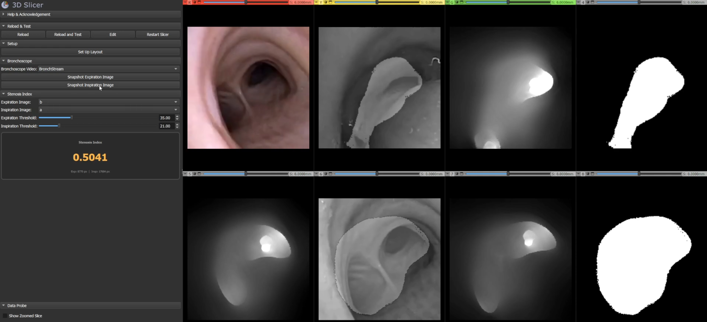

# Airway Stenosis Quantification

A 3D Slicer extension for estimating airway stenosis index from bronchoscopic images using cGAN-based depth estimation.

## Overview

This project provides tools to quantify airway stenosis by comparing depth maps generated from expiration and inspiration bronchoscopic images. A pre-trained CycleGAN generator estimates depth from grayscale bronchoscopic frames, and a configurable threshold produces binary airway segmentations used to compute the Stenosis Index (SI).

## Modules

### [v1.0](1.0/README.md) — Original Module

The initial implementation. Supports loading bronchoscopic image files, ground truth SI calculation from CT segmentation, and estimated SI from depth maps with manual marker placement.

### [v2.0](2.0/README.md) — Rewritten Module

A rewrite with live bronchoscope support. Features real-time depth estimation from a video feed via OpenIGTLink, snapshot capture, interactive threshold sliders, and an auto-updating stenosis index display.

## Citation

A. Banach, M. Naito, F. King, F. Masaki, H. Tsukada, N. Hata. "Computer-based
airway stenosis quantification from bronchoscopic images: preliminary results
from a feasibility trial." *International Journal of Computer Assisted Radiology
and Surgery* 18(4) (2023): 707–713. https://doi.org/10.1007/s11548-022-02808-8

## License

This project is licensed under the [BSD 3-Clause License](LICENSE).
